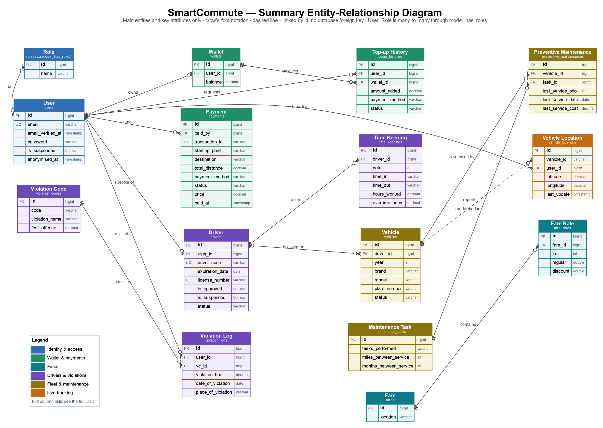
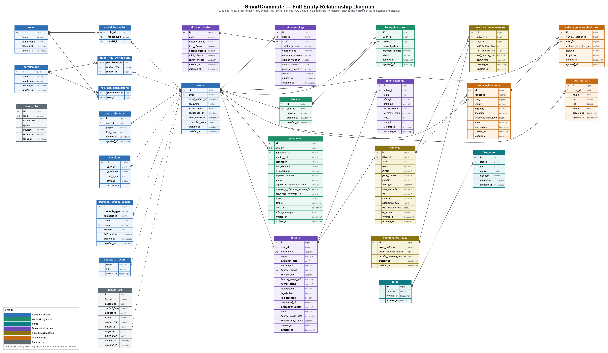

# Entity-Relationship Diagrams — SmartCommute

Two views of the same database, both generated from the final state of `database/migrations/*.php`
(41 migrations; later `ALTER`s applied; `vehicle_maintenance_logs`, `routes` and `fleets`, which migrations drop, are not shown):

| Diagram | Use it for | Files |
|---|---|---|
| **Summary ERD** — 15 main entities, key columns only | Reports, slides, onboarding | [PNG](diagrams/erd_summary.png) · [SVG](diagrams/erd_summary.svg) |
| **Full ERD** — all 27 tables, every column | Developers, data dictionary | [PNG](diagrams/erd_full.png) · [SVG](diagrams/erd_full.svg) |

Notation is crow's foot: `||` exactly one · `|o` zero or one · `>o` zero or many.
A **dashed** line means the tables are linked by an id column but the database has **no foreign key** for it.
Both diagrams are produced by [`diagrams/build_erd.py`](diagrams/build_erd.py) (needs Graphviz); edit the `SCHEMA` / `REL`
data at the top of that script after a migration and re-run `python3 docs/diagrams/build_erd.py`.

> **Verified against the live database on 2026-10-21** (after the `routes` / `fleets` drop, the `activity_log` index and the account-erasure migration were applied): the 27 tables, every
> column with its nullability and primary key, and all 21 foreign keys match `information_schema` exactly: 18 are `ON DELETE CASCADE` and 3 (payments and top-ups) are `RESTRICT`.
> Re-check after a migration; the comparison is a few lines against `information_schema.columns` / `key_column_usage`.

---

## 1. Summary ERD

### What the entities are

| Entity | Table | Holds | Related UCNs |
|---|---|---|---|
| User | `users` | Every account — commuter, driver, staff, admin — with email, hashed password, verification and suspension state, and `anonymised_at` (set when the account was erased but kept because payments reference it) | E001, E002, E008, E018, E027, E028 |
| Role | `roles` | The five roles (via `model_has_roles`; Spatie permission package) | FR-RBAC |
| Wallet | `wallets` | A commuter's stored balance | E005, E006 |
| Top-up History | `topup_histories` | One row per wallet top-up, with a status | E005 |
| Payment | `payments` | One row per fare payment, including gateway ids and lifecycle status | E006, E007 |
| Fare / Fare Rate | `fares`, `fare_rates` | A published fare guide and its distance tiers (regular and discount price) | E004, E019 |
| Driver | `drivers` | Driver profile attached to a user: licence, approval, suspension, availability | E012, E022 |
| Time Keeping | `time_keepings` | One row per driver per day: in, out, hours, overtime, leave | E009, E010, E013 |
| Violation Code | `violation_codes` | Offence catalogue with fines for 1st–4th+ offence | E014, E024 |
| Violation Log | `violation_logs` | A violation recorded against a driver's user account | E014 |
| Vehicle | `vehicles` | A fleet vehicle, optionally assigned to a driver | E015 |
| Maintenance Task | `maintenance_tasks` | A kind of service and its km / month interval | E017 |
| Preventive Maintenance | `preventive_maintenances` | Last service of one task on one vehicle — the junction that makes Vehicle ↔ Task many-to-many | E016 |
| Vehicle Location | `vehicle_locations` | A vehicle's latest broadcast position | E021, E003 |

### Relationships

| Parent | Child | Foreign key | Meaning | On parent delete |
|---|---|---|---|---|
| User | Wallet | `wallets.user_id` | owns (0..1) | cascade (only reached when there is no payment or top-up — see §3) |
| Wallet | Top-up History | `topup_histories.wallet_id` | receives | **restrict** |
| User | Top-up History | `topup_histories.user_id` | requests | **restrict** |
| User | Payment | `payments.paid_by` | pays | **restrict** |
| User | Driver | `drivers.user_id` | is profile of (0..1) | cascade |
| Driver | Time Keeping | `time_keepings.driver_id` | records | cascade |
| Driver | Vehicle | `vehicles.driver_id` (nullable) | is assigned | cascade |
| User | Violation Log | `violation_logs.user_id` | is cited in | cascade |
| Violation Code | Violation Log | `violation_logs.vc_id` | classifies | cascade |
| Vehicle | Preventive Maintenance | `preventive_maintenances.vehicle_id` | is serviced by | cascade |
| Maintenance Task | Preventive Maintenance | `preventive_maintenances.task_id` | is performed in | cascade |
| Fare | Fare Rate | `fare_rates.fare_id` | contains | cascade |
| User | Vehicle Location | `vehicle_locations.user_id` (nullable) | broadcasts | cascade |
| Vehicle | Vehicle Location | `vehicle_locations.vehicle_id` | reports — **no foreign key** (dashed) | none |
| User ↔ Role | — | via `model_has_roles` | has (many-to-many) | pivot rows are not removed with the user (no foreign key) |

---

## 2. Full ERD

*The PNG is large (≈4,500 px wide). For a document, use the SVG and zoom, or paste the PNG on a landscape page.*

### Table groups

| Group (colour) | Tables |
|---|---|
| Identity & access (blue) | `users`, `user_preferences`, `roles`, `permissions`, `model_has_roles`, `model_has_permissions`, `role_has_permissions`, `personal_access_tokens`, `sessions`, `password_resets` |
| Wallet & payments (green) | `wallets`, `topup_histories`, `payments` |
| Fares (teal) | `fares`, `fare_rates` |
| Drivers & violations (purple) | `drivers`, `time_keepings`, `violation_codes`, `violation_logs` |
| Fleet & maintenance (olive) | `vehicles`, `maintenance_tasks`, `preventive_maintenances` |
| Live tracking (orange) | `vehicle_locations`, `vehicle_location_histories`, `dev_markers` |
| Framework (dark grey) | `activity_log`, `failed_jobs` |

### Tables not in the summary

| Table | Purpose |
|---|---|
| `user_preferences` | Per-user theme and font size (1 : 0..1 with `users`). |
| `permissions`, `role_has_permissions`, `model_has_permissions` | Spatie permission tables. The seeder gives the admin role four `… routes` permissions, but no code checks a permission — access is decided by **role** only. |
| `model_has_roles` | Links a user (`model_type` + `model_id`, polymorphic) to a role. |
| `personal_access_tokens` | Laravel Sanctum API tokens (polymorphic `tokenable`). |
| `sessions` | Server-side sessions; `user_id` is indexed but has no foreign key. |
| `password_resets` | Reset tokens keyed by email, not by user id. |
| `vehicle_location_histories` | Breadcrumb row for each accepted position broadcast (E021). |
| `dev_markers` | Developer-only synthetic map markers (E021 A4, `local` environment). |
| `activity_log` | The audit trail ([AUDIT_TRAIL.md](AUDIT_TRAIL.md)); `causer_id` / `subject_id` are polymorphic, no foreign key. Indexed on `log_name`, causer, subject and — since `2026_10_21_100000` — `created_at`. Read by the admin Activity Log page (UCN_SC_E029). |
| `failed_jobs` | Laravel queue failures. |

---

## 3. Things the diagrams show that the UCNs do not say

1. **`routes` and `fleets` were removed.** They were created early, never used (no model, controller, view, seeder or test touched them;
   `fleets` also duplicated `vehicles`) and are dropped by `2026_10_21_090000_drop_unused_routes_and_fleets_tables` — applied on the
   dev database on 2026-10-21. Any other environment still has them until `php artisan migrate` is run there.
   By contrast **`vehicle_locations` is essential**: it is the only source of the live map and ETA (E003), the table the driver
   broadcast writes (E021), and the parent of `vehicle_location_histories`.2. **`vehicle_locations.vehicle_id` is a plain string with no foreign key** to `vehicles.id`, and `vehicle_locations` has
   no unique key per vehicle. The link exists only in code (E021), so a deleted vehicle can leave position rows behind.
3. **Deleting a user can no longer destroy the ledger.** Every other foreign key to `users` still cascades (wallet, preferences, location rows, driver profile and from it
   timekeeping, violation logs…), but `payments.paid_by`, `topup_histories.user_id` and `topup_histories.wallet_id` are `RESTRICT`: a delete that would remove a payment or
   top-up is refused by the database. The application never relies on that — `User::eraseAccount()` deletes an account that has none, and **anonymises** one that has
   (email → `deleted-<id>@deleted.invalid`, password, roles, tokens, sessions, preferences and driver profile removed, `anonymised_at` set, suspended), keeping the user row, wallet, payments and top-ups.
   Rows with no foreign key — role assignments, sessions, API tokens, password-reset rows and `activity_log` entries — are not removed by either path except as `anonymise()` does explicitly.
   (Before 2026-10-21 everything cascaded, so a commuter deleting their account erased their payment history.)
4. **`vehicles.driver_id` cascades from `drivers`.** Deleting a driver row would delete the vehicle row. The application
   prevents this (E012 E8: a driver with a vehicle cannot be deleted), but the database would not.
5. **`violation_logs.user_id` points at `users`, not `drivers`.** A violation belongs to the driver's *user account*;
   it is not linked to the driver profile directly.
6. **One vehicle per driver is an application rule.** The schema allows a driver many vehicles (`vehicles.driver_id`
   is not unique); E015 enforces one.
7. **`time_in` / `time_out` are strings** (`"08:00"` or `"08:00 AM"`), not times (noted in E009 / E013).
8. **`payments.paid_at` is nullable** since the gateway lifecycle migration (a pending payment has none).
9. **`violation_codes.code` and `maintenance_tasks.tasks_performed` are not unique** at the database level (E014, E017).
