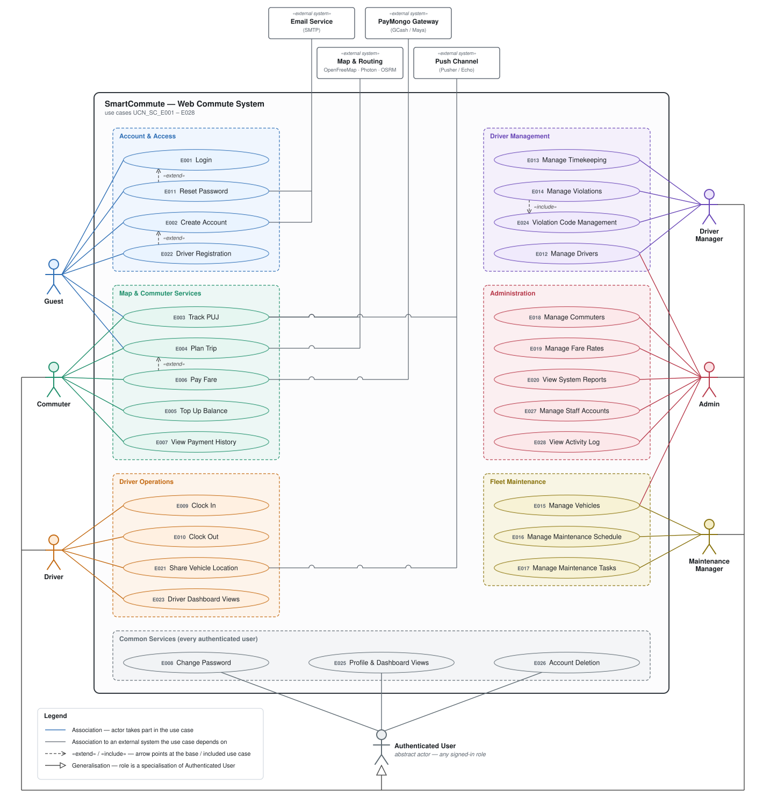

# Use-Case Diagram — SmartCommute

UML use-case diagram for the whole system, built from the 27 Use Case Narratives in [`UCN/`](UCN/README.md)
(`UCN_SC_E001` – `E028`; `E025` is unassigned in the UCN set).

*Also available as [PNG](diagrams/use_case_diagram.png) (2× resolution). The SVG is generated by
[`diagrams/build_use_case_diagram.py`](diagrams/build_use_case_diagram.py) — edit the data block at the top of that
script and re-run it with `python3 docs/diagrams/build_use_case_diagram.py`.*

## Split diagrams (for Google Docs / Word)

The full diagram above is one tall page. These are the same content broken into page-sized pieces. Google Docs and Word
do not accept SVG, so use the **PNG** (2× resolution, white background): *Insert → Image → Upload from computer*.

| # | Diagram | Shows | PNG |
|---|---|---|---|
| 1 | Overview | The 7 feature packages and which roles use them | [01_overview.png](diagrams/use-case-parts/01_overview.png) |
| 2 | Account & Access | E001, E002, E011, E022 (public) and E008, E026, E027 (every signed-in user); Email Service | [02_account_and_access.png](diagrams/use-case-parts/02_account_and_access.png) |
| 3 | Map & Commuter Services | E003–E007; Map & Routing, Push Channel, PayMongo | [03_map_and_commuter_services.png](diagrams/use-case-parts/03_map_and_commuter_services.png) |
| 4 | Driver Operations | E009, E010, E021, E023; Push Channel | [04_driver_operations.png](diagrams/use-case-parts/04_driver_operations.png) |
| 5 | Driver Management | E012, E013, E014, E024; Admin shares E012 | [05_driver_management.png](diagrams/use-case-parts/05_driver_management.png) |
| 6 | Fleet Maintenance | E015, E016, E017; Admin shares E015 | [06_fleet_maintenance.png](diagrams/use-case-parts/06_fleet_maintenance.png) |
| 7 | Administration | E018, E019, E020, E028 | [07_administration.png](diagrams/use-case-parts/07_administration.png) |

SVG versions sit beside each PNG. They are regenerated with `python3 docs/diagrams/build_use_case_parts.py`, which reads
its content from `build_use_case_diagram.py` so the pieces and the full diagram cannot drift apart.

Companion documents: [Functional Requirements](Functional_Requirements.md) ·
[Non-Functional Requirements](Non_Functional_Requirements.md) ·
[Entity-Relationship Diagrams](Entity_Relationship_Diagram.md)

---

## 1. Actors

| Actor | Type | Description | UCN term |
|---|---|---|---|
| **Guest** | Primary | Unauthenticated visitor. Can browse the public map, plan a trip, register and sign in. | `/map/guest` |
| **Commuter** | Primary | Authenticated user with the `commuter` role. Tops up a wallet, pays fares, reviews payments. | `role:commuter` |
| **Driver** | Primary | Authenticated user with the `driver` role, an approved `Driver` profile and (to broadcast) a staff-assigned vehicle. | `role:driver` |
| **Driver Manager** | Primary | Back-office staff who run the driver roster, timekeeping and violations. | `role:driver_manager` |
| **Maintenance Manager** | Primary | Back-office staff who run the fleet and preventive maintenance. | `role:maintenance_manager` |
| **Admin** | Primary | System administrator: commuters, fare rates, reports, staff accounts; may also use the driver and vehicle pages. | `role:admin` |
| **Authenticated User** | Abstract | Generalisation of the five signed-in roles above. Holds the use cases every signed-in user has (E008, E026, E027). | — |
| **Email Service** | Secondary (external) | Mail transport that delivers verification and password-reset links. | E002, E011 |
| **Map & Routing Services** | Secondary (external) | OpenFreeMap tiles (MapLibre GL), Photon geocoding, OSRM routing. | E003, E004 |
| **PayMongo Gateway** | Secondary (external) | Hosted checkout and signed webhooks for GCash / Maya fares. Optional, flag-controlled. | E006 |
| **Push Channel** | Secondary (external) | Pusher / Laravel Echo channel `vehicle-locations` that carries live (obfuscated) positions. | E003, E021 |

## 2. Use-case catalogue by actor

`●` = primary actor · `○` = secondary / documented additional access. Use-case names follow the UCN sheets.

| ID | Use case | Guest | Commuter | Driver | Driver Mgr | Maint. Mgr | Admin | Any signed-in |
|---|---|:-:|:-:|:-:|:-:|:-:|:-:|:-:|
| [E001](UCN/UCN_SC_E001_Login.md) | Login | ● | | | | | | |
| [E002](UCN/UCN_SC_E002_Create_Account.md) | Create Account | ● | | | | | | |
| [E003](UCN/UCN_SC_E003_Track_PUJ.md) | Track PUJ | ● | ● | | | | | |
| [E004](UCN/UCN_SC_E004_Plan_Trip.md) | Plan Trip | ● | ● | | | | | |
| [E005](UCN/UCN_SC_E005_Topup_Balance.md) | Top Up Balance | | ● | | | | ○ (monitor) | |
| [E006](UCN/UCN_SC_E006_Pay_Fare.md) | Pay Fare | | ● | | | | | |
| [E007](UCN/UCN_SC_E007_View_Payment_History.md) | View Payment History | | ● | | | | ○ (audit receipts) | |
| [E008](UCN/UCN_SC_E008_Change_Password.md) | Change Password | | | | | | | ● |
| [E009](UCN/UCN_SC_E009_Clock_In.md) | Clock In | | | ● | | | | |
| [E010](UCN/UCN_SC_E010_Clock_Out.md) | Clock Out | | | ● | | | | |
| [E011](UCN/UCN_SC_E011_Reset_Password.md) | Reset Password | ● | | | | | | |
| [E012](UCN/UCN_SC_E012_Manage_Drivers.md) | Manage Drivers | | | | ● | | ● | |
| [E013](UCN/UCN_SC_E013_Manage_Timekeeping.md) | Manage Timekeeping | | | | ● | | | |
| [E014](UCN/UCN_SC_E014_Manage_Violations.md) | Manage Violations | | | | ● | | | |
| [E015](UCN/UCN_SC_E015_Manage_Vehicles.md) | Manage Vehicles | | | | | ● | ○ | |
| [E016](UCN/UCN_SC_E016_Manage_Maintenance_Schedule.md) | Manage Maintenance Schedule | | | | | ● | | |
| [E017](UCN/UCN_SC_E017_Manage_Maintenance_Tasks.md) | Manage Maintenance Tasks | | | | | ● | | |
| [E018](UCN/UCN_SC_E018_Manage_Commuters.md) | Manage Commuters | | | | | | ● | |
| [E019](UCN/UCN_SC_E019_Manage_Fare_Rates.md) | Manage Fare Rates | | | | | | ● | |
| [E020](UCN/UCN_SC_E020_View_System_Reports.md) | View System Reports | | | | | | ● | |
| [E021](UCN/UCN_SC_E021_Share_Vehicle_Location.md) | Share Vehicle Location | | | ● | | | | |
| [E022](UCN/UCN_SC_E022_Driver_Registration.md) | Driver Registration | ● | | | | | | |
| [E023](UCN/UCN_SC_E023_Driver_Dashboard_Views.md) | Driver Dashboard Views | | | ● | | | | |
| [E024](UCN/UCN_SC_E024_Admin_Violation_Code_Management.md) | Violation Code Management | | | | ● | | | |
| [E026](UCN/UCN_SC_E026_Profile_and_Dashboard.md) | Profile & Dashboard Views | | | | | | | ● |
| [E027](UCN/UCN_SC_E027_Account_Deletion.md) | Account Deletion | | | | | | | ● |
| [E028](UCN/UCN_SC_E028_Manage_Staff_Accounts.md) | Manage Staff Accounts | | | | | | ● | |

## 3. Relationships between use cases

| Relationship | Base use case | Added use case | Why (UCN reference) |
|---|---|---|---|
| «extend» | E001 Login | E011 Reset Password | Reached from the *Forgot Password* link on the login page (E011 trigger). |
| «extend» | E002 Create Account | E022 Driver Registration | The registration page offers the driver sign-up path instead (E002 A3). |
| «extend» | E004 Plan Trip | E006 Pay Fare | After a route is calculated the commuter may press *Buy a Ride* (E004 A4; E006 precondition). |
| «include» | E014 Manage Violations | E024 Violation Code Management | Logging a violation needs a maintained violation-code table; E014 A1–A4 is the same function as E024. |

## 4. Modelling notes

- **Grouping.** The dashed packages inside the system boundary group use cases by the part of the product they belong to;
  they carry no UML meaning beyond layout. Each use case is labelled with its UCN id so the diagram traces straight to
  the narratives.
- **Authenticated User.** E008 Change Password, E026 Profile & Dashboard Views and E027 Account Deletion are available
  to every signed-in role, so they hang off the abstract *Authenticated User* actor instead of drawing 15 separate lines.
  (E026 is role-specific *content*: the profile page is commuter-only and the dashboard is staff-only — see its UCN.)
- **Guest vs. Commuter.** Track PUJ and Plan Trip are drawn for both. Commuter is *not* drawn as a specialisation of Guest,
  because that would also give Commuters Login / Create Account.
- **Admin access to other roles' pages.** The diagram shows the two cases the narratives name as shared with the Admin
  (E012 Manage Drivers, E015 Manage Vehicles). The Admin's read-only visibility of other pages (E005 top-up list, E007
  receipt ledger, and the "read-only role boundaries" noted on E013/E014/E016/E017) is listed in the catalogue above
  but left off the diagram to keep it readable.
- **Driver ↔ Track PUJ.** E021 Share Vehicle Location is what *feeds* E003 Track PUJ (through the Push Channel); there is
  no direct UML relationship between them, so the link is expressed through the shared external actor.
- **External systems** are drawn only where the narratives list them as a secondary or supporting actor. The PDF-parsing
  script in E019 and the activity log are internal components and are not shown.
